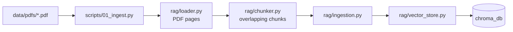
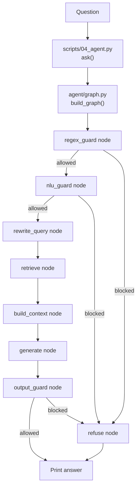

# Beginner's Guide to the HR Agent Code

This guide follows one question from the command line through the files that
process it. It also shows how HR policy PDFs become searchable before the agent
starts.

## Start here

The main program is [`scripts/04_agent.py`](scripts/04_agent.py). It is the
command-line entry point: it reads a question, builds the agent graph, sends
the question to that graph, and prints the trace and answer.

Before using the agent for the first time, run
[`scripts/01_ingest.py`](scripts/01_ingest.py) to load PDFs into ChromaDB. This
is a preparation step, not something `04_agent.py` calls for each question.

## The two flows

### Prepare the searchable HR documents

In more detail:

1. `01_ingest.py` reads the settings and calls `load_pdfs` in
   [`src/hr_agent/rag/loader.py`](src/hr_agent/rag/loader.py).
2. The loader extracts text and page numbers from PDFs in `data/pdfs/`.
   [`src/hr_agent/rag/models.py`](src/hr_agent/rag/models.py) defines the
   `Page` and `Chunk` data shapes used by these steps.
3. The script calls `chunk_pages` in
   [`src/hr_agent/rag/chunker.py`](src/hr_agent/rag/chunker.py) to split each
   page into overlapping word chunks.
4. It passes those chunks to `store_chunks` in
   [`src/hr_agent/rag/ingestion.py`](src/hr_agent/rag/ingestion.py). That
   function uses [`src/hr_agent/rag/vector_store.py`](src/hr_agent/rag/vector_store.py)
   to replace the ChromaDB collection and save the chunks. ChromaDB creates
   local embeddings for the text.

The database is read later by the agent's retrieval step. If the PDFs change,
run ingestion again to refresh the stored chunks.

### Answer one question

The graph is assembled once when the program starts. For each question,
`ask()` sends `{"question": question}` to it. The graph then runs the nodes in
order, sharing a state dictionary as it goes. Each node returns only the new
values it computed; LangGraph merges those updates into the shared state.

## Exactly what calls what

| Order / event | File and function | What it calls or does next |
| --- | --- | --- |
| Program starts | [`scripts/04_agent.py`](scripts/04_agent.py) — `main()` | Adds `src/` to Python's import path, parses an optional question, and calls `build_graph()`. If no question was supplied, it repeatedly prompts until `quit` or `exit`. |
| Build graph | [`src/hr_agent/agent/graph.py`](src/hr_agent/agent/graph.py) — `build_graph()` | Registers node functions from `agent/nodes.py`, connects their edges and conditional routes, then compiles the graph. It does not run the question yet. |
| Submit question | [`scripts/04_agent.py`](scripts/04_agent.py) — `ask()` | Calls `graph.stream({"question": question}, stream_mode="updates")`. For every node update, it prints a short status using `describe()` and remembers any `answer`. |
| 1. Check input patterns | [`src/hr_agent/agent/nodes.py`](src/hr_agent/agent/nodes.py) — `regex_guard_node()` | Calls `check_input_regex()` in [`src/hr_agent/guardrails/regex_guard.py`](src/hr_agent/guardrails/regex_guard.py). Oversized input or a matching blocked pattern is denied. |
| Decide whether to continue | [`src/hr_agent/agent/nodes.py`](src/hr_agent/agent/nodes.py) — `route_after_guard()` | The graph calls this after each guard. If the latest result is denied, it routes to `refuse`; otherwise it continues to the next node. |
| 2. Check the topic | [`src/hr_agent/agent/nodes.py`](src/hr_agent/agent/nodes.py) — `nlu_guard_node()` | Calls `check_input_nlu()` in [`src/hr_agent/guardrails/nlu_guard.py`](src/hr_agent/guardrails/nlu_guard.py). It classifies the question; only the `hr` label is allowed. |
| 3. Make a search query | [`src/hr_agent/agent/nodes.py`](src/hr_agent/agent/nodes.py) — `rewrite_query_node()` | Calls `rewrite_query()` in [`src/hr_agent/rag/query_rewriter.py`](src/hr_agent/rag/query_rewriter.py), which asks the agent LLM for a concise HR search query. |
| 4. Find document chunks | [`src/hr_agent/agent/nodes.py`](src/hr_agent/agent/nodes.py) — `retrieve_node()` | Calls `retrieve()` in [`src/hr_agent/rag/retriever.py`](src/hr_agent/rag/retriever.py), passing the rewritten query and `settings.top_k`. The retriever queries the ChromaDB collection through `vector_store.py`. |
| 5. Assemble evidence | [`src/hr_agent/agent/nodes.py`](src/hr_agent/agent/nodes.py) — `build_context_node()` | Calls `build_context()` in [`src/hr_agent/rag/context_builder.py`](src/hr_agent/rag/context_builder.py), which numbers the chunks and includes their source and page. |
| 6. Draft answer | [`src/hr_agent/agent/nodes.py`](src/hr_agent/agent/nodes.py) — `generate_node()` | Calls `generate_answer()` in [`src/hr_agent/rag/generator.py`](src/hr_agent/rag/generator.py). The generator sends the question and retrieved context to the agent LLM and asks it to cite sources. |
| 7. Check the draft | [`src/hr_agent/agent/nodes.py`](src/hr_agent/agent/nodes.py) — `output_guard_node()` | Calls `check_output()` in [`src/hr_agent/guardrails/output_guard.py`](src/hr_agent/guardrails/output_guard.py). A separate guardrail LLM checks that the answer is grounded and safe. |
| Give final response | [`src/hr_agent/agent/nodes.py`](src/hr_agent/agent/nodes.py) — `refuse_node()` if needed | If any guard denies the request, this selects the matching refusal message. Otherwise the graph finishes with the generated answer. `ask()` prints the resulting answer in a panel. |

The guardrail functions return a `GuardrailResult` (guard name, allow/block
decision, and reason) defined in
[`src/hr_agent/guardrails/result.py`](src/hr_agent/guardrails/result.py).
The full list of results is kept in `guardrail_results`.

## When the question stops early

- If the regex check blocks the question, the graph goes directly to `refuse`.
  The topic classifier, document search, and answer generation do not run.
- If the NLU check blocks it, the graph goes to `refuse` before query rewriting
  or document search.
- If the output check blocks the generated draft, `refuse` replaces the draft
  with a safer response.
- Only when both input checks allow the question does it go through retrieval
  and answer generation.

This is why `describe()` in `04_agent.py` can display different trace entries:
the graph streams an update only for a node that actually ran.

## What the other scripts are for

The other scripts are small demonstrations of parts of the application; the
main agent does not call them:

| Script | Purpose | Main modules it calls |
| --- | --- | --- |
| [`scripts/01_ingest.py`](scripts/01_ingest.py) | Prepare or refresh the document database | `rag/loader.py`, `rag/chunker.py`, `rag/ingestion.py` |
| [`scripts/02_search.py`](scripts/02_search.py) | Try query rewriting, retrieval, and context building without the graph | `rag/query_rewriter.py`, `rag/retriever.py`, `rag/context_builder.py` |
| [`scripts/03_guardrails.py`](scripts/03_guardrails.py) | Try the input and output checks directly | The three modules under `guardrails/` |
| [`scripts/04_agent.py`](scripts/04_agent.py) | Run the complete graph for a question | `agent/graph.py`, which orchestrates the nodes and their modules |

## Supporting files used across the flow

- [`src/hr_agent/config.py`](src/hr_agent/config.py) reads `.env` settings and
  defines paths for PDFs, training data, and ChromaDB, plus model and retrieval
  settings.
- [`src/hr_agent/llm.py`](src/hr_agent/llm.py) creates the configured agent and
  guardrail chat models when they are first needed.
- [`src/hr_agent/agent/state.py`](src/hr_agent/agent/state.py) defines the
  fields passed between graph nodes: question, search query, chunks, context,
  answer, and guardrail results.
- [`tests/test_graph.py`](tests/test_graph.py) checks the allowed path and
  early-refusal paths. It substitutes fake LLM and database functions so these
  tests run offline.

## A good reading order

1. [`scripts/04_agent.py`](scripts/04_agent.py): see how to run the program.
2. [`src/hr_agent/agent/graph.py`](src/hr_agent/agent/graph.py): see the
   sequence and branches.
3. [`src/hr_agent/agent/nodes.py`](src/hr_agent/agent/nodes.py): see what each
   step does.
4. [`src/hr_agent/agent/state.py`](src/hr_agent/agent/state.py): see what data
   moves between steps.
5. Follow a single branch into its guardrail or RAG module from the table above.

For the setup instructions and lessons for each script, see
[`README.md`](README.md).
